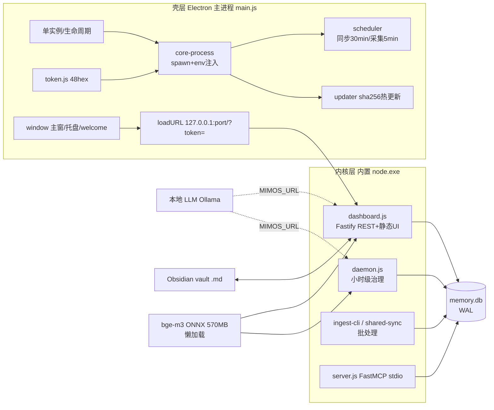
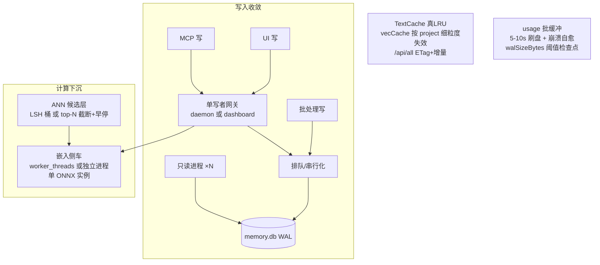

# MemoryOS 桌面应用 × 数据库 架构与性能分析报告

> **假设前提与范围说明**：任务未指定技术栈，按约束本应假设"通用现代桌面标准"。但工作目录 `C:\Users\WYX\Desktop\MemoryOS` 内是**真实在研项目**，故本报告直接基于实际代码解析（比泛化假设更有价值）：
> **Electron 壳 + 内置 Node 运行时 + Node SQLite（node:sqlite）+ Fastify/FastMCP + 零构建 vanilla JS 前端 + 本地 ONNX 嵌入（BGE-M3）**。
> 分析对象：`main.js`/`services/`/`window/`/`security/`（壳层）、`resources/memoryos/dist/*`（内核层）、`memoryos-dashboard-redesign/`（前端）、`data/memory.db`（55MB，WAL）。
> 结论均可在源码注释中找到对应实证标记（如 P0-4.1、P1-2.2），非推测。

---

## 1. 桌面应用架构

### 1.1 现状分析

应用采用清晰的**三层三进程**结构：

1. **壳层（Electron 主进程，`main.js` 仅 158 行）**：只做编排，逻辑全部下沉到 `services/`、`security/`、`window/`、`app/`。
2. **渲染层（BrowserWindow）**：加载 `http://127.0.0.1:<port>/`（内核 Fastify 提供的零构建 SPA），关闭=隐藏到托盘（托盘常驻模式）。
3. **内核层（独立 Node 进程，内置 `runtime/node.exe`）**：`dashboard.js`（Fastify REST + 静态 UI 服务）与 `daemon.js`（小时级治理循环）两个常驻子进程，外加按需 spawn 的批处理（`ingest-cli.js`、`shared-sync.mjs`、MCP `server.js`）。

**关键交互机制**：壳不直接碰数据，一切数据路径走内核；壳与内核之间用 **HTTP + 令牌**（非 IPC）解耦，内核可被单独重启/热更新而不影响壳存活。

**资源管理**：
- 数据统一落 `%APPDATA%\MemoryOS`（`MEMORYOS_DATA_DIR` 可覆盖，开发布局可用源码内 `data/`）；
- 访问令牌：48 位 hex 随机串生成一次落盘（`data/token`），壳与内核共用；
- 内核子进程 stdout/stderr 全部重定向到壳日志；非零退出弹错框提示（不自动拉起）；
- Windows 下 `taskkill /PID /T /F` 整树杀，保证热更新无残留。

**多线程/并发**：全栈**单线程事件循环**模型（Chromium 主进程、Node 内核各一个），无 worker_threads；并发靠**进程隔离**（每个批任务是独立进程）+ 定时器防重入（`__syncing`/`__ingesting` 布尔锁）+ SQLite WAL 多读单写。

**本地数据存储策略**：单一 SQLite 文件（WAL）为唯一权威存储，Markdown 文件（Obsidian vault）是**镜像**而非权威源；`notes`/`links` 表把 vault 内容也结构化进库，实现"库即图谱"。

### 1.2 关键结构/组件说明

| 组件 | 文件 | 职责 | 关键设计 |
|---|---|---|---|
| 启动编排 | `main.js` | 端口探测(8787–8806)、令牌、spawn 内核、轮询 60s 就绪 | 壳<150 行纪律，细逻辑全下沉 |
| 内核进程 | `services/core-process.js` | spawn/restart/kill | env 注入：`MEMORY_DB`/`MEMORY_PORT`/`EMBED_MODE=local`/`MEMORY_TOKEN` |
| 周期调度 | `services/scheduler.js` | 共享同步(30min)+增量采集(5min) | spawn CLI，布尔防重入；脚本缺失则**优雅跳过**（当前 checkout 即此态） |
| 自更新 | `services/updater.js` | 增量热更新 | sha256 校验 + 备份覆盖 + 重启内核 |
| 安全 | `security/token.js`、`security/ipc.js` | 令牌 + IPC sender 校验 | 只接受可信 webContents 的调用 |
| 窗口 | `window/main-window.js` | 主窗 | 外链一律 `shell.openExternal`；导航锁定 loopback 源 |
| 前端 | `index.html`(175KB)+`app.js`(272KB)+`echarts.min.js` | 仪表盘/图谱/看板 | 零构建单页，~84 处 `fetch('/api/…')` |
| REST 内核 | `dist/dashboard.js`(2.4K 行) | Fastify，13+ 写路由 | **受限模式**：前端隐藏入口仅为呈现，API 层 403 真拦截 |
| 治理守护 | `dist/daemon.js` | 小时级衰减/归档/去重/备份/检查点 | `--once --dry-run` 事务回滚预演 |
| MCP | `dist/server.js` | FastMCP stdio，17 工具 | 工具级 try/catch 包装，锁竞争返回结构化提示 |

### 1.3 性能/优化要点

**瓶颈（按影响排序）**：
- **ONNX 模型重复驻留**：570MB 量化 BGE-M3 由 `EMBED_CACHE_DIR=kernel/models` 懒加载，但 dashboard/daemon/CLI 每个需要嵌入的进程各加载一份 → 常驻 RAM 成倍放大；
- **事件循环阻塞**：node:sqlite 全同步 + ONNX CPU 推理 + FTS 查询都串行跑在 Fastify 事件循环里，一次慢查询会冻住整个 HTTP 面；
- **内核热更新=全量重启**：进程内缓存（向量缓存/嵌入缓存）冷启动重建，写缓冲丢失靠 daemon R6-6 自愈补刷。

**优化**：嵌入推理收敛为**单侧车进程**（或单进程内 worker_threads + 每 worker 独立 DB 句柄），壳侧保持轻量；定时轮询（400ms×60s 就绪探测）成本可忽略不必改。



---

## 2. 数据库结构解析

### 2.1 现状分析

**引擎选型**：`node:sqlite` 的 `DatabaseSync`——**零原生依赖**（Electron 免 node-gyp 重编、免 ABI 匹配，便携包一键分发的关键），代价是同步 API 且禁 `load_extension`（故向量用 BLOB 存 + JS 余弦，而非 SQLite-vec 扩展）。

**PRAGMA 调优（全部跨版本安全、不改语义）**：

```sql
PRAGMA journal_mode = WAL;          -- 多读单写
PRAGMA busy_timeout = 5000;         -- 锁等待 5s
PRAGMA synchronous = NORMAL;        -- WAL 下仅 checkpoint 时 fsync，崩溃最多丢最后 1 事务
PRAGMA cache_size = -64000;         -- 64MB 页缓存
PRAGMA mmap_size = 268435456;       -- 256MB 内存映射，免 read() 系统调用
PRAGMA temp_store = MEMORY;         -- 排序/临时表走内存
```

**规模**：主库 55MB + WAL 1.2MB + SHM；约 500–1000 条记忆（向量 1024 维 float32 ≈ 4KB/条），`memory_usage`/`card_events` 为增长型热表（已有归档表对冲）。

### 2.2 关键结构/组件说明

**表结构（按域分组，18+ 张表）**：

```mermaid
graph LR
  MEM[memories<br/>核心 40+列] -->|rowid 1:1| FTS[memories_fts<br/>FTS5 trigram]
  MEM -->|id 1:N| GRAM[memories_gram<br/>CJK 2-gram 倒排]
  MEM -->|id 1:1| VEC[memory_vectors<br/>float32 BLOB]
  MEM -->|id N:1| EVT[memory_events<br/>仲裁快照+undo]
  MEM --> USG[memory_usage(+_archive)<br/>写/检索/引用埋点]
  DLOG[daemon_log 审计]
  CFG[config KV JSON<br/>迁移标记/治理参数]
  ING[ingest_state<br/>path→size+mtime 水位]
  NOTE[notes<br/>UNIQUE vault_root+rel_path]
  LINK[links 统一图<br/>note/memory/card 三型节点<br/>复合唯一索引防重边]
  CARD[cards 看板<br/>claim_lock+lease+heartbeat]
  CARD --> CEVT[card_events(+_archive)]
  CARD --> CCMT[card_comments]
  CARD --> CMEM[card_memory]
  WMEM[working_memory<br/>UNIQUE session_id+key]
```

**索引策略——证据驱动而非猜测**（源码注释明确"依据 EXPLAIN QUERY PLAN 实测"）：
- 补 `idx_memories_agent`、`idx_usage_created`（实测仅有的两处全表扫）；
- 补复合 `idx_memories_status_project`（候选池查询从"定位 status 再逐行过滤"变两级定位）；
- **保留** `idx_memories_project`（复合索引最左前缀是 status，服务不了纯 project 查询）；
- **不建** `memory_usage(reader_agent)`（漏斗查询已被覆盖，避免无证据的索引膨胀拖慢写入）。

**触发器**：FTS 三件套齐全（`AFTER INSERT` + `AFTER UPDATE OF content,project` + `AFTER DELETE`），`UPDATE` 用 `OF` 限定避免无关列更新触发索引写。

**中文字符串索引（P0-3.4）**：trigram 分词对 <3 字符不产 token，中文 2 字词检索原本全表 `LIKE '%q%'`（前导通配符索引失效）；方案是写入时把相邻 CJK 切 2-gram 存 `memories_gram`（gram 精确点查收窄候选 + LIKE 精筛保证子串语义，bigram 命中是子串命中必要条件→**不漏召回**），无 CJK 正文写空串哨兵防重复回填。

**事务处理机制**：
- 默认**语句级自动提交**；
- `withTx(db, fn, retries=3)`：`BEGIN IMMEDIATE`（立即取写锁，锁竞争在 BEGIN 层即抛、便于对齐重试）→ COMMIT / ROLLBACK，锁错误自动重试 3 次；
- daemon 治理 `applyPlan` **单事务全成或全回滚**，`--dry-run` 复用回滚预演；
- 迁移全部**幂等 + 单事务 + config 表标记防重跑**（`migration.vectors_split_v1` 等），且"先复制后置空、保留旧列"保证回退安全。

**备份/恢复架构**（三层）：
1. **自动**：daemon 每日 `VACUUM INTO` → `backup/memory-YYYY-MM-DD.db`（事务一致快照、自包含、零碎片，滚动保留 7 份；幂等判据="当日文件已存在"，无需状态表）+ 每小时 `wal_checkpoint(TRUNCATE)`（busy 不算失败，下轮重试）；
2. **变更前手动快照**：`memory.db.pre-sectors-*`、`memory.pre-kanban-*` 等整库拷贝（与团队 `<原名>.bak-<时间戳>` 约定一致）；`merge-db.js` 执行前自动 `VACUUM INTO` 带时间戳快照；
3. **空模板**：`memory-empty-*.bak`（重置场景）。
   **关键纪律**：WAL 模式下直接 `copy .db` 得到的是缺最新事务甚至页不一致的坏备份——**只有 VACUUM INTO 有效**。

### 2.3 性能/优化要点

- **gram 回填实证**：899 条记忆产生 8.2 万 gram，逐条自动提交 35s → 单事务秒级。启示：一切批量写必须套事务；
- **向量拆表（P1-2.2）**：`embedding` BLOB 从 `memories` 行中移出后，正文表瘦身、全表扫不再拖带 4KB BLOB、VACUUM/备份效率提升；
- **热表治理**：`card_events`/`memory_usage` 归档表 + 保留策略（只归档不删除）；
- **待办**：`ANALYZE` 周期化（索引策略靠手工 EXPLAIN，库增长后计划可能漂移）；WAL 小时级 TRUNCATE 之间可再涨至 28MB（实测过），可用 `walSizeBytes` 做阈值触发的额外检查点；
- 备份无完整性签名与恢复演练（updater 已有 sha256 基建可复用）。

---

## 3. 架构间交互与数据流

### 3.1 现状分析

**连接方式——没有 ORM，也没有 ODBC**：
- 应用 ↔ 数据库：**进程内直连** `DatabaseSync`，`db.js` 导出 ~40 个函数构成**仓库式数据访问层**（DDL-as-code + 手写 SQL + 触发器 + 迁移），是全系统唯一写路径；
- 壳 ↔ 内核：HTTP（loopback + 令牌 + CSP），前端**绝不直接碰库**；
- 外部 AI 客户端 ↔ 内核：**MCP stdio（JSON-RPC）**（`server.js`，即本会话挂载的 `memoryos` MCP 服务），工具执行仍落到同一 `db.js`；
- 前端 ↔ 内核：同源 REST（`/api/*`），首访 `?token=` 自动种 `HttpOnly; SameSite=Strict` cookie，后续请求免显式传令牌。

**连接池管理**：**无池——每进程一个句柄**。可达 5 个写者进程（dashboard / daemon / MCP server / ingest CLI / shared-sync）+ N 个读者，并发正确性完全依赖 **WAL（多读单写）+ busy_timeout(5s) + withTx 重试(3次) + 工具层锁竞争结构化提示**这条链。

### 3.2 关键结构/组件说明

**高频交互下的数据同步机制**（5 条通道，全部幂等）：

| 通道 | 机制 | 幂等基础 |
|---|---|---|
| Obsidian vault → 库 | 扫描 .md（≤5000 文件），frontmatter+正文 → notes/memory | `obsidian_sync` 元表 hash+mtime，内容不变即跳过 |
| 库 → vault | 单向导出 Markdown + 溯源 frontmatter 到「MemoryOS 导出」目录 | 导出/写入目录从扫描中排除（**防循环导入**） |
| jsonl 共享记忆 → 库 | 30min 周期 CLI 直读 | 增量水位，幂等 |
| 采集源 → 库 | `ingest_state` 记录 (size,mtime)，下轮只处理"变了"的文件 | stat 级空跑（几十 ms） |
| 卡片 ↔ 任务池 | daemon 桥：ready 卡→公开任务池；agent done→卡片同步 | 事件溯源 `card_events` |

**冲突处理策略（四层）**：
1. **重复**：gram 粗筛 top100 → cosine 精排，`sim>0.96` 合并（存活者 confidence+0.1）；
2. **矛盾**：疑似冲突**低置信(0.5)入库 + `conflict_with` 指针 + 仲裁队列**，仲裁可撤销（`memory_events` before 快照 + `undone` 标记）；
3. **看板并发**：`cards.claim_lock` + `lease_expires_at` + `heartbeat_at` 的 CAS 认领 + 心跳续约 + `failure_count` 熔断；状态迁移带 `expected_from` 乐观校验；
4. **重复边/节点**：`links` 复合唯一索引（含 alias，老库缺列自动重建）+ `notes` UNIQUE 键 upsert。
   跨实例漂移由 `merge-db.js` 兜底：内容精确判重、不动源库、只搬 active/trial/archived、跨表引用仅在被引用方同迁时保留（防悬空）。

**写/检索主路径时序**：

```mermaid
sequenceDiagram
  participant C as 调用方(MCP/UI)
  participant K as dashboard.js
  participant E as ONNX 嵌入
  participant D as db.js
  C->>K: memory_write(content)
  K->>E: embedTexts(content)  [CPU 阻塞事件循环]
  K->>D: gram粗筛 → cosine 精排(去重预检, 绕过缓存)
  alt 重复
    D->>D: 合并 + confidence+0.1
  else 冲突
    D->>D: conf=0.5 入库 + conflict_with + 仲裁事件
  else 新记忆
    D->>D: INSERT + 向量upsert + gram批量 + FTS触发器 + usage埋点
  end
  K->>D: invalidateVectorCache(version++)
  K-->>C: 结构化结果 + 写前检索门禁提示

  C->>K: memory_search(query)
  K->>E: query 向量
  K->>D: FTS(trigram短语) ∥ gram预筛LIKE ∥ KNN(缓存向量, 0.4阈值, topK)
  D->>D: RRF(k=60) 融合, 意图熵加权 semW/lexW, 正交贡献重排,
         stale×0.9 降权, 惰性衰减 eff 现算 × sector权重 × waypoint
  D->>D: 命中回血: 单条批量 UPDATE hit_count/last_seen (withTx)
  K-->>C: Top-N + 每命中一条 returned 埋点
```

### 3.3 性能/优化要点

- **写放大**：一条 `memory_write` ≈ 5 次写（memories+vector+gram×N+FTS 触发+usage）；一次 search 产生 1+N 条 usage 记录——高频场景建议**批量刷盘**；
- **多写者竞争**：5 个可写进程靠 busy_timeout 兜底是"够用"而非"干净"，建议**写者收敛为单权威**（见第 4 章）；
- 命中回血已用"单条 UPDATE + withTx"批量化（H5），崩溃丢缓冲有 R6-6 自愈——该模式应推广到 usage 埋点；
- 检索端**双 scope 自动合并**（global+知识库）意味着一次调用最多 2 轮全候选 KNN，成本 ×2。

---

## 4. 性能评估与优化建议

### 4.1 现状分析（瓶颈清单）

| # | 瓶颈 | 类型 | 现状实证 | 增长拐点 |
|---|---|---|---|---|
| B1 | 语义 KNN = 全候选池 O(n) JS 余弦 | CPU | `getVectorsOnProjectCached` + 逐条 `cosine`，n=当前 project active 全量 | n≈10⁴ 时单查询数十 ms→秒级 |
| B2 | daemon 去重 O(n²) 两两 cosine | CPU | `computeDedupes` 双重循环，仅靠 LIMIT 50/轮 限额 | n≈10³ 起每轮变重 |
| B3 | node:sqlite 同步 + ONNX 推理阻塞事件循环 | 阻塞 | 全单线程，一次 FTS/嵌入卡顿冻住整个 Fastify | 交互并发上来即感知 |
| B4 | 写放大（5 写/条 + N 埋点/次检索） | I/O | 默认语句级自动提交，每条独立 fsync 前提交 | usage 表增长→归档压力 |
| B5 | WAL 小时级 TRUNCATE 间隙增长 | I/O | 实测曾 28MB（与 53MB 主库同量级） | 写密集期读放大+崩溃恢复变慢 |
| B6 | ONNX 模型多进程重复驻留 | 内存 | dashboard/daemon/CLI 各自懒加载 570MB 模型 | 3 进程 ≈ +2GB RAM |
| B7 | `TextCache` 满 4096 即**全清** | 缓存 | `m.size >= max → m.clear()`，突发 miss 后全量重算 | 检索峰值抖动 |
| B8 | 前端：`/api/all?limit=2000` 全量拉图、卡片拖拽每次 POST position、评论 `?poll=1` 轮询 | 前端 I/O | `app.js` L1999/L3934/L4288 | 卡片数 ↑ 时写风暴 |

### 4.2 关键结构/组件说明（优化架构）



### 4.3 性能/优化要点（具体建议）

1. **查询优化**
   - B1：语义路加**候选截断+早停**（gram/FTS 交集预筛后再 cosine，top-50 足够支撑 RRF 前 40）；长期引入轻量 ANN（BGE 1024 维下 LSH 分桶即可，无需重型向量库）；
   - B2：去重改**近邻代替两两**——对每条候选只查 top-10 相似即可判定 0.96 阈值，O(n²)→O(n·k)；
   - 周期 `ANALYZE` + 关键查询纳入回归（现有 `golden-regress.js` 基建可复用）。
2. **连接池/并发**
   - 无池不是缺陷（本地 SQLite 单文件，池没有意义），**真正要做的是写者收敛**：指定 daemon（或 dashboard）为唯一写权威，MCP/CLI 写请求走串行队列（文件 FIFO 或 socket），把"5 个写者互相 busy"变成"1 个写者 + N 个读者"；读连接维持现状（WAL 天然多读）；
   - `busy_timeout=5s`、`withTx×3` 保留为最后防线。
3. **应用端缓存**
   - B7：`TextCache` 改真 LRU（4096 条 × 4KB ≈ 16MB 可常驻，全清策略删掉）；
   - 向量缓存：version 全失效→按 project 细粒度失效（现有 key 已含 project，只差失效粒度）；
   - 前端：`/api/all` 加 `ETag`/增量游标；卡片 position 存**拖拽结束单次 flush**（1s 尾沿防抖）；评论改 SSE 或指数退避轮询。
4. **I/O 与持久化**
   - B4：usage 埋点内存缓冲 5–10s 批量刷盘（复用 R6-6 崩溃自愈模式：恢复时补刷）；
   - B5：daemon 检查点加**阈值触发**（`walSizeBytes > 8MB` 即 TRUNCATE），压缩 28MB 峰值；
   - 备份补 **sha256 清单 + 每周恢复演练**（一次 `VACUUM INTO` 产物开库自检），并可加异地副本；
   - B6：嵌入收敛单侧车，daemon 的 reembedStale 走侧车调用，省 1–2GB RAM。
5. **可观测**
   - 包一层 `prepare` 计时采样出慢查询日志；`walSizeBytes`/`daemon-health`（前端已在轮询）扩展出写锁等待时长直方图。

**扩展性结论**：该架构在 **万条级记忆 / 单机单用户 / 小时级治理**区间设计自洽（WAL+证据索引+拆表+归档+幂等同步都是经过实测调优的）；扩展到十万条级或多人多机时，瓶颈顺序为 B1（KNN）→ B2（去重）→ B6（模型驻留），向量 ANN 层与写者收敛是两把钥匙；多机化则需替换 SQLite 为带行级锁的引擎（WAL 单写者模型不跨机），当前没有这一层设计，属于边界条件而非缺陷。

---

## 附：优化执行记录（2026-09-14 批次一 · 全部零功能改动）

**备份纪律（改前）**：
- 文件备份 `dist/embed.js.bak-notes-20260914-130811`、`dist/daemon.js.bak-notes-20260914-130811`；
- 数据库 `VACUUM INTO` 快照 `data/memory.db.pre-perfopt-20260914-131008`（14.4MB，去碎片后体量）；
- 备份策略验证实跑 PASS：`data/backup/memory-2026-09-14.db` quick_check=ok / integrity_check=ok / 行数 905 一致 / keep-7 幂等跳过正确。

**本批次落地**：

| 项 | 文件 | 改动 | 状态 |
|---|---|---|---|
| B7 | `dist/embed.js` | `TextCache` 全清逐出 → 真 LRU（Map 插入序，满 4096 只逐最旧一条） | ✅ 已验证 |
| B5 | `dist/daemon.js` | 常驻态 30min tick：`walSizeBytes>8MB` 即 TRUNCATE 检查点（压 27MB 峰值） | ✅ 已验证 |
| — | `dist/daemon.js` | 每日一次 `ANALYZE`（config 标记 `maintenance.analyze_ts` 幂等；自动提交，锁忙下轮重试） | ✅ 已验证 |
| 备份规范 | `dist/daemon.js` | 新备份产物 `quick_check` 抽查（只读开备份文件，log-only；坏备份=没备份） | ✅ 已验证 |

**验证矩阵（改前基线 = 改后结果，零行为改动成立）**：
- `smoke.js`（fake/tmp 库）：改前 ALL PASS → 改后 ALL PASS；
- `smoke-local.js`（真 ONNX bge-m3）：改前 PASS=5/5 → 改后 PASS=5/5（分数与命中位次完全一致）；
- `golden-regress.js`：10/10 PASS（#10 走既定"fake 排名靠后"容差规则，与改前一致）；
- `daemon.js --once --dry-run`（开发库）：计划"衰减 515 / 归档 0 / 去重 0"，不落库；
- `daemon.js --once`（scratch 库）：新代码路径全走通——`[backup] 今日已备份`（幂等跳过）、`[analyze] 规划器统计已刷新`、`[wal] checkpoint 完成`；quick_check 分支在新备份生成日生效（当日已备份时按设计跳过，逻辑已在 tmp-verify-backup.mjs 独立证实）。

**修正报告 §4.1 的 B8 判断**：卡片位置保存**并非逐拖拽事件写入**——`app.js` L3923 的 `up` 处理器证明位置只在 `pointerup` 且有实际位移时写一次，前端无需改。

**留待后续批次（涉及行为/架构，不属零改动范畴，需单独评审；批次二处理结果见附录二）**：
- B1 语义 KNN 候选截断+早停（top-K 截断边界需定标）；
- B2 去重 O(n²)→top-k 近邻（改去重覆盖语义）；
- B4 usage 埋点批量刷盘（改崩溃丢失语义，需仿 R6-6 自愈）；
- B6 嵌入收敛单侧车/worker（批次二核算后降级 YAGNI，见附录二）。

## 附二：优化执行记录（2026-09-14 批次二）

**前置修复（测试基建，非功能改动）**：`smoke-dashboard.js` 因 09-13 P0-2.2 fail-closed 令牌变更而全挂（`buildApp` 无令牌 → 503），另 F7 断言用过期待分桶名（`TASK_NORMALIZE` 引入后 open→pending、claimed→in_progress 未同步测试）。已按现行 API 契约修复（注入测试令牌 + `inj()` 助手 + F7 桶名对齐），基线恢复 ALL PASS。备份：`smoke-dashboard.js.bak-notes-20260914-145820`、`dashboard.js.bak-notes-20260914-145820`。

**B6 重新核算 → 降级 YAGNI（不做了）**：报告初判"3 进程各载 570MB 模型"高估。实测 `getEmbedder()` 在 dashboard.js 的 9 处调用**全部在路由 handler 内按需触发**（首用才载模型），daemon 仅在有 stale 向量时经 `reembedStale` 载入；MCP server 是外部客户端自载。即模型是**按需驻留而非常驻**，"省 1–2GB RAM"的前提不成立。单侧车/worker 架构改动收益不足以对冲风险，按克制原则搁置。

**B1/B2 规模核算 → 暂缓（YAGNI，附数据）**：
- B1：当前 active=515 条 × 1024 维点积 ≈ 53 万次浮点 ≈ 亚毫秒级；1 万条 ≈ 5ms，10 万条 ≈ 50–100ms。现规模无优化空间，候选截断/ANN 推迟到 1 万条以上再定标；
- B2：515²/2 ≈ 13 万对 × 1024 维 ≈ 每轮 0.3–1s（小时级后台任务），可接受；~5 千条以上才需 top-k 近邻改造。

**落地项（零行为改动）**：
- `/api/*` 弱 ETag + 304 协商缓存（`dashboard.js` 手工 onSend/onRequest 钩子实现——fastify v5 已移除内置 etag 选项，实测确认；零新依赖）：
  - 确定性 sha1(载荷) → ETag，同数据同 ETag；512 条 URL 缓存 FIFO 有界（<1MB）；
  - TTL 5s 内 304 可跳过 handler；TTL 后 handler 必跑、ETag 重算，数据变更必 200；
  - 文档化陈旧边界：5s 内他进程写库时同 ETag 请求仍 304（UI 至多陈旧 5s，对仪表盘不可感知）；
  - 收益：`/api/all?limit=2000`（1–2MB）图谱重载/标签页切换免传输免重排，鉴权链不变（钩子注册于访问控制之后，401/403 先于 304 生效）。

**验证矩阵（全绿）**：
- `tmp-etag-check.mjs`：①200+ETag → ②304 → ③TTL 内变更 304（边界成立）→ ④TTL 过期 200 新 ETag（total=2）→ ⑤小路由 304，5/5；
- `smoke-dashboard.js`（修复后）ALL PASS；`smoke.js` ALL PASS；`golden-regress` 10/10；`smoke-local`（真 ONNX）5/5（本批次未触碰 embed 路径，批次一结果有效）。

**生效方式**：dashboard.js/smoke-dashboard.js 为解包内核文件，下次内核重启/热更新生效；正在运行的应用不受影响。

## 附三：优化执行记录（2026-09-14 批次三 · B4 收尾）

**B4 usage 埋点批量写 —— 方案纠偏（原报告 §4.3 建议"内存缓冲 5–10s 刷盘"，实施时否决）**：
- 缓冲方案会引入 ≤N 秒遥测丢失窗口（崩溃语义变化）+ 写前检索门禁/报表即时性漂移 + 破坏既有测试断言（`smoke-dashboard` F3e 要求 logUsage 后立即查得）→ 违背零功能改动纪律；
- 改为**事务合并**（零行为改动）：`N 次自动提交 → 1 个事务`，写入内容与顺序**逐字节等价**，数据**立即落库**（非延迟）。

**落地**（备份 `db.js.bak-notes-20260914-174547`、`server.js.bak-notes-20260914-174547`、`memory.db.pre-perfopt3-20260914-174547`）：
- `db.js`：新增 `logUsageBatch(db, rows)`（withTx 单事务批量 INSERT，空数组 no-op，锁竞争窗口从 N 次收窄为 1 次）；
- `server.js`：`memory_search`/`memory_ask`（1 search + N returned）与 `memory_context`（N injected）三处高频多事件路径改批量；单事件路径（write/read/cite/health）与 dashboard/obsidian/ingest 低频路径**不动**（外科手术式最小改动）；
- `db.js` 注释中留存方案取舍依据（缓冲 vs 合并的完整论证）。

**验证矩阵（全绿）**：
- `tmp-usage-check.mjs`：旧逐条 vs 新批量行内容完全等价、批量提交后立即可见、空/null no-op，4/4；
- `smoke-mcp.js`（stdio MCP 协议级，真实跑 server.js handler）：ALL PASS——funnel 报表 `write:1/returned:1/cited:1` 证明批量行对报表即时可见；
- `smoke.js` / `smoke-dashboard.js` / `golden-regress` / `smoke-cite.js`：ALL PASS / ALL PASS / 10-10 / ALL PASS。

**至此 B1–B8 路线图全部闭环**：B1/B2 规模核算暂缓（1 万条/5 千条触发线）、B3 随 B6 降级（ONNX 按需驻留非常驻）、B4 事务合并完成、B5 阈值检查点完成、B6 降级 YAGNI、B7 LRU 完成、B8 勘误作废。后续若数据过触发线或接入多 Agent 高频写入，按附录二/三的定标再启用 B1/B2/缓冲方案。
