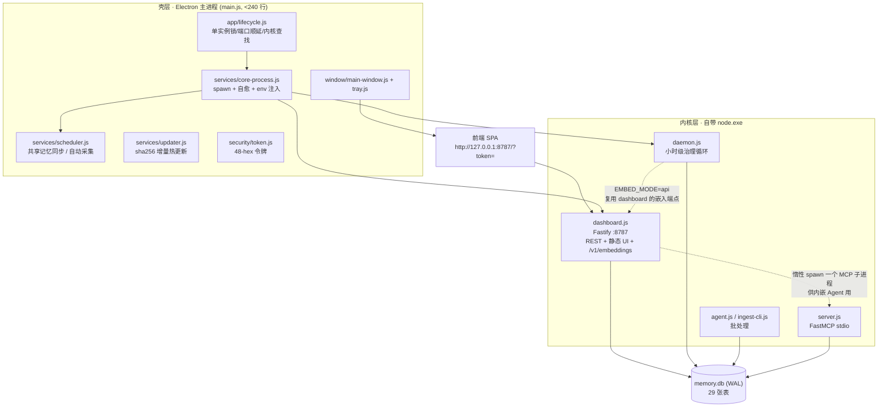
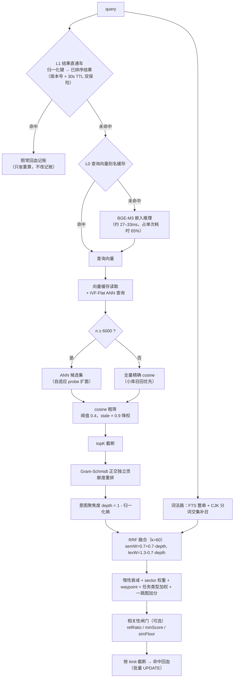

# MemoryOS 架构设计说明

> 用途：写给外部架构评审方（Claude）。目标是让评审者在不读全部源码的情况下，准确理解**这套系统是什么、由哪些部件构成、关键机制怎么运转、哪些地方作者自己已经知道有问题**，从而给出可落地的改进建议。
>
> 本文所有描述均来自对当前工作树的直接阅读（`c:\Users\WYX\Desktop\MemoryOS`），不含推测。规模数字为实测（文件行数/字节数/表数量/路由数量）。
>
> 评审请求：**请重点评审第 18 章列出的「已知痛点与开放问题」，同时欢迎指出作者自己没意识到的架构缺陷。** 作者最关心的是：分层是否合理、耦合是否过深、有没有结构性缺陷会随规模增长而爆发、以及哪些复杂度是「过度设计」。

---

## 1. 一句话定位

MemoryOS 是**单机、单用户、供多个 AI Agent 共享的长期记忆库 + 多 Agent 协同工作台**。

它解决的核心问题是：同一个人手上的多个 AI 编码助手（Trae / Codex / ZCode / WorkBuddy / Claude 等）彼此不知道对方做过什么、踩过什么坑、定过什么约定。MemoryOS 提供一份**落盘的共享记忆**，通过 MCP 协议让所有 Agent 读写同一份事实源，同时提供看板让人来管理这些记忆、编排任务、观察 Agent 行为。

一句话技术画像：**Electron 桌面壳 + 内置 Node 运行时 + 单文件 SQLite（WAL）+ Fastify REST + FastMCP stdio + 零构建 vanilla JS 前端 + 本地 ONNX 嵌入（BGE-M3）**，全栈无编译步骤、无原生依赖。

---

## 2. 规模实测（供评审判断复杂度是否失控）

| 维度 | 实测值 |
|---|---|
| 内核层源码 | `resources/memoryos/dist/` 共 **94 个 .js 文件**，合计约 **1.6 MB**，约 **1.7 万行**（手工维护，`dist/` 即源码，**无构建步骤**） |
| 最大单文件 | `dashboard-reg-cards.js` 2173 行 / 139 KB；`db.js` 2070 行 / 120 KB；`server-reg-task.js` 1348 行；`server-reg-memory.js` 1187 行；`dashboard-reg-knowledge.js` 1213 行 |
| REST 路由 | 约 **179 条** `app.get/post/put/patch/delete`（散落在 15 个 `dashboard-reg-*.js` + dashboard.js） |
| MCP 工具 | **26 个常驻工具** + **3 个执行面工具**（默认关闭） |
| 数据库表 | **29 张表**（`db.js` SCHEMA） |
| 前端 | 零构建单页：`index.html` 413 KB + `app.js` 546 KB + vendored `echarts.min.js` 1010 KB |
| 壳层 | `main.js` + `services/*`(6) + `security/*`(2) + `window/*`(4) + `app/lifecycle.js` |
| 测试 | 24 项 `smoke-*.js` 自动发现聚合（`npm test`）+ 3 个 lint（语法/SQL 占位符/静默 catch）+ 路由快照比对 |

> **评审者请注意**：这是一个**单人长期迭代**的项目，代码注释风格是「考古层」式的——几乎每处改动都保留了改动理由、被否决的方案、以及实证数据。注释密度极高（部分文件注释占比 30%+）。这既是优点（决策可追溯）也是缺点（信噪比低、单文件过长）。

---

## 3. 分层架构与进程模型

### 3.1 四层 + 两态

| 层 | 物理位置 | 职责 |
|---|---|---|
| **壳层** | 仓库根：`main.js`、`window/`、`services/`、`security/`、`app/` | 窗口与托盘、端口分配、访问令牌、内核进程自愈、热更新、IPC |
| **内核层** | `resources/memoryos/dist/` | MCP 服务、HTTP 看板、治理守护、内嵌 Agent、采集同步、执行面 |
| **前端** | `resources/memoryos/memoryos-dashboard-redesign/` | `index.html` + `app.js`（可直接改，热生效，无构建） |
| **运行时/模型** | `resources/memoryos/runtime/node.exe`、`models/`（BGE-M3 ONNX） | 自带 Node（不依赖系统 Node）+ 本地嵌入模型 |

两条交付形态共用同一内核与同一份数据目录（`%APPDATA%/MemoryOS/`）：

- **桌面版**：`MemoryOS.exe`（仓库根，Electron）
- **便携版**：`resources/memoryos/launcher.cjs`（单文件 SEA 入口，起 dashboard 并用浏览器打开）
- 另有**实验性手机版**：`android/phone-kernel/`（Termux 环境跑同一内核，通过 `MEMORY_HOST=0.0.0.0` + `MEMORY_ALLOW_LAN=1` 与桌面配对）

### 3.2 进程模型



**关键设计决策**：

1. **壳不碰数据**。壳只负责启动/守护/更新，所有数据路径走内核。壳与内核之间是 **HTTP + 令牌**（不是 Electron IPC），因此内核可以独立重启/热更新而不影响壳存活。
2. **内核进程自愈**（`services/core-process.js`）：指数退避（base 3s × 2^(n-1)，封顶 60s）+ 每脚本独立计数 + 存活满 60s 则计数归零 + 额度耗尽（默认 5 次）弹框交由人处理。三项防风暴补丁：
   - **幂等守卫**：`startCore` 按脚本查自家存活子进程，活着就跳过（否则 daemon 崩 → 把活着的 dashboard 再拉一份 → EADDRINUSE 秒退 → 自愈风暴）。
   - **EADDRINUSE 隔离**：dashboard 抢不到端口 = 已有实例在服务，不计入自愈额度，按 60s 间隔轻量重试。
   - **主动重启窗口** `restarting`：`restartCore()` 杀出的旧子进程 exit 不再排自愈。
3. **内核重启 = 全量重启**：进程内缓存全部冷启动重建；系数靠 daemon 自愈补刷。
4. **嵌入模型收敛为单实例**：daemon 不再进程内驻留 560 MB 的 BGE-M3，改经 dashboard 常驻的 `/v1/embeddings`（OpenAI 兼容、Bearer=同一令牌）复用同一份模型（`EMBED_MODE=api`）。这是对早期「三进程各载一份 570MB 模型」的正解。
5. **全栈单线程事件循环**：Chromium 主进程、Node 内核各一个；无 `worker_threads`；并发靠**进程隔离** + 定时器防重入布尔锁 + SQLite WAL 多读单写。

---

## 4. 壳层（Electron）细节

| 模块 | 职责 | 关键机制 |
|---|---|---|
| `main.js` | 纯编排（目标 <150 行） | 装配 core/updater/scheduler；托盘创建**提前到 `startCore()` 之前**（Win11 会静默丢弃迟到注册的托盘图标） |
| `app/lifecycle.js` | 单实例锁、端口顺延、内核目录解析 | `findFreePort(8787–8806)`；启动前先 `readConfig()`，无配置则开首次配置窗 |
| `services/core-process.js` | 内核 spawn/重启/kill + 自愈 | env 注入 `MEMORY_DB` / `MEMORY_PORT` / `EMBED_MODE=local` / `MEMORY_TOKEN` / `MIMOS_URL` / `MEMORY_RESTRICTED` / `MEMORYOS_EXEC_ON` |
| `services/scheduler.js` | 周期调度 | 共享记忆同步 30 min + 自动采集 5 min；spawn CLI，布尔锁防重入 |
| `services/updater.js` | 自研增量热更新 | sha256 清单校验 + 备份覆盖 + 重启内核；签名私钥存仓库外 |
| `services/port.js` / `sign-manifest.js` | 端口探测 / 发布签名 | |
| `security/token.js` | 访问令牌生成/存储/轮换 | 48-hex，落 `%APPDATA%/MemoryOS/data/token` |
| `security/ipc.js` | IPC 注册 + `event.sender` 校验 | 只接受可信 webContents 的调用 |
| `window/main-window.js` | 主窗 | 注入 `memoryos_token` cookie；失败回退 `?token=`；外链一律 `shell.openExternal`；导航锁定 loopback |
| `window/welcome-window.js` | 首次配置窗 | LLM 端点/模型配置 |
| `window/tray.js` + `window/tray-native/tray-native.cs` | 托盘 | **已知硬缺陷**：本机 Windows 托盘注册通道损坏（11 项排除实验证明，任何程序含微软标准实现都注册不上）；现用原生 C# 辅助进程方案，附带无法隐藏的黑窗 |
| `pack-asar.js` | 重打包 `resources/app.asar` | 只纳入 `SYNC_FILES` 白名单；**改壳层源码必须重打包才生效** |

**⚠ 生效路径陷阱（作者自己标记的高频踩坑）**：
- **内核** `resources/memoryos/dist/*.js` → **直接从磁盘加载**，改完只需重启内核，**无需 pack-asar**。
- **壳层** `main.js`/`security/*`/`window/*` → **必须 `node pack-asar.js`** 重打包才生效，且重打包前须退出 MemoryOS（asar 被占用）。
- 作者曾因此误操作（"改了壳层源码以为重启就好"）。

---

## 5. 内核层模块地图

`dist/` 94 个文件按职责分为 10 组：

### 5.1 HTTP 服务 / 路由（15 个 `dashboard-reg-*.js` + `dashboard.js`）

`dashboard.js`（345 行）只做装配：建 Fastify 实例、装访问控制、装统一错误处理、然后把 15 个路由域注册函数依次调用（`registerCore` → `registerMemory` → `registerPlans` → `registerIngest` → `registerDesktop` → `registerStatic` → `registerCards` → `registerKnowledge` → `registerWorkbench` → `registerTerm` → `registerGithub` → `registerDesign` → `registerCliExec` → `registerCdpExec`）。共享顶层名（`db` / `restricted` / `clampLimit` / `UI_DIR` 等）通过一个 `ctx` 对象注入，以避免 `reg → dashboard` 的循环 import。

| 注册模块 | 路由域 | 行数 |
|---|---|---|
| `dashboard-reg-core.js` | 汇总/健康/settings | 283 |
| `dashboard-reg-memory.js` | 记忆 CRUD、搜索 | 232 |
| `dashboard-reg-plans.js` | 计划导入/apply、规则同步、Agent 扫描与连接 | 559 |
| `dashboard-reg-ingest.js` | 采集源、审计、各类健康度 | 319 |
| `dashboard-reg-desktop.js` | Obsidian vault、技能同步 | ~100 |
| `dashboard-reg-static.js` | 静态资源下发（含内存驻留缓存） | ~60 |
| `dashboard-reg-cards.js` | **卡片看板核心**（卡片 CRUD、认领、派发、状态机、连线、位置、图谱） | 2173 |
| `dashboard-reg-knowledge.js` | 图谱、笔记、**内嵌 Agent 对话/run/会话**、导出、LLM 配置、执行开关 | 1213 |
| `dashboard-reg-workbench.js` | worktree 编排 / diff / 行级批注 / 拖拽上传 | 425 |
| `dashboard-reg-term.js` | 准终端（`exec_run` 流式版 SSE） | 158 |
| `dashboard-reg-github.js` | GitHub 集成（读侧全功能，写侧降级） | 257 |
| `dashboard-reg-design.js` | Design Mode（CDP 元素拾取） | 330 |
| `dashboard-reg-cliexec.js` | CLI 直控执行器（headless 智能体 + SSE 终端） | 345 |
| `dashboard-reg-cdpexec.js` | CDP 驾驶执行器（拉起桌面 App + screencast 直播） | 810 |

### 5.2 MCP 工具服务（4 个）

- `server.js`（197 行）：内核 —— FastMCP 实例、`addTool` 覆写层（统一 try/catch + 风险前缀注入）、共享原语（`stateReceipt` / `runTaskTx` / 凭据校验）、执行面按 env 注册、CLI 入口与 `--list-tools`。
- `server-reg-memory.js`（1187 行）/ `server-reg-obsidian.js` / `server-reg-task.js`（1348 行）：按域拆分的工具注册。
- `tool-guides.js`（51 行）：工具详规按需查询（描述一行化，对标 Orca 的分片加载）。

### 5.3 数据层

- `db.js`（2070 行）：**全系统唯一写路径**，DDL-as-code + 手写 SQL + 触发器 + 迁移 + ~40 个导出函数（仓库式数据访问层）。**禁止反向 import `embed.js` 等 ML 层**（否则 543 MB ONNX 运行时会被所有 DB 调用点强制加载）。
- `ann.js`（166 行）：纯 JS IVF-Flat 近似最近邻索引（因 `node:sqlite` 禁 `load_extension`，sqlite-vec 不可用，必须自己实现）。

### 5.4 检索 / 嵌入

- `search.js`（696 行）：混合检索管线（详见第 7 章）。
- `embed.js`（249 行）：嵌入适配层，四模式 `local` / `api` / `fake` / 默认（详见第 7 章）。
- `bench-retrieval.js` / `eval-suite.js` / `calibrate-simfloor.js` / `reembed.js` / `embed-backfill.js` / `baseline.js` / `regress.js` / `golden-regress.js`：检索评测与回归基建。

### 5.5 治理守护

- `daemon.js`（983 行）：小时级治理循环（衰减/归档/去重/备份/检查点/ANALYZE/图谱蒸馏/规则反思/任务对账）。
- `reconcile.js`（209 行）：三方对账（任务头 ↔ 卡片 ↔ dispatch）+ 进化双回归门。
- `graph-distill.js`（194 行）：知识图谱蒸馏（memory→memory 关系，24 h 窗口）。
- `rule-reflection.js`（184 行）：每日规则反思生产线（对 `AGENTS.md` 等规则文件自动提炼）。
- `arbitrate.js` / `report.js` / `snapshot-routes.js` / `merge-db.js`：仲裁、报表、路由快照、跨库合并。

### 5.6 Agent 子系统

- `agent.js`（273 行）：CLI Agent（REPL / 单问 / `--work` 任务队列 / `--loop` 轮询 / `--resume` 续做）。
- `agent-core.js`（465 行）：LLM 调用 + MCP 客户端 + 工具循环 + `writeGate` 门禁解析（解析工具描述里的 `⟨risk:Lx|gate:...⟩` 前缀）。
- `agent-stream.js`：流式输出。
- `agent-runs.js`（372 行）：run 注册表（内存态最近 50 + `agent_runs` 表持久化）。
- `a1-bootstrap.js`：A1 短生命周期凭据批量签发 CLI。
- `auto-connect.js`：自动连接引导。
- `secret-store.js`：DPAPI（Windows 用户作用域）加密密钥存储（`llmKeyEnc`）。
- `scan.js`（875 行）：扫描本机已安装的 AI Agent 客户端并生成 MCP 接入配置。
- `llm.js`：LLM 端点探测与归一化。

### 5.7 采集与同步

- `ingest.js`（789 行）/ `ingest-cli.js`：采集源（含 `trae-session-jsonl` 等 L1 免 LLM 源）。
- `obsidian-sync.js`（767 行）：Obsidian vault 双向同步（导入 / 导出 / 笔记索引 / 链接降级）。
- `skill-sync.js`（343 行）：把共享技能同步到各 Agent 的技能目录。
- `sync-rules.js`（285 行）：把记忆中的规则同步注入各 Agent 的规则文件（`AGENTS.md` 等）。

### 5.8 执行面（高风险区）

- `exec-tools.js`（298 行）：`file_read` / `file_write` / `exec_run` + TOOL_RISK 风险表 + 输出预算 + 审计。
- `dashboard-exec-util.js`：执行器共享工具。
- `audit-probe.js`：执行面审计探针。

### 5.9 测试与质量门禁

`smoke-all.js`（自动发现 24 项 `smoke-*.js`）、`smoke-mcp.js`、`smoke-dashboard.js`、`smoke-task.js`、`smoke-agent*.js`、`smoke-p26-lifecycle.js`、`lint-syntax.js`（枚举 `dist/*.js` 逐一 `node --check`）、`lint-sql-arity.js`、`lint-silent-catch.js`。

### 5.10 启动与少量工具

`start-dashboard.js` / `restart-core.js` / `seed.js` / `format.js` / `task-status-map.js` / `dashboard-task-util.js` / `dashboard-reg-*.js`。

---

## 6. 数据层设计

### 6.1 引擎选型与取舍

`node:sqlite` 的 `DatabaseSync`（Node 内置）。

- **收益**：零原生依赖 → Electron 免 `node-gyp` 重编、免 ABI 匹配，是「便携包一键分发」的关键。
- **代价**：**全同步 API**（阻塞事件循环）；**禁 `load_extension`** → 无法用 sqlite-vec，向量只能存 BLOB + JS 余弦，ANN 只能自己写纯 JS IVF-Flat。

### 6.2 PRAGMA 调优

```sql
PRAGMA journal_mode = WAL;          -- 多读单写
PRAGMA busy_timeout = 5000;         -- 锁等待 5s
PRAGMA synchronous = NORMAL;        -- WAL 下仅 checkpoint 时 fsync
PRAGMA cache_size = -64000;         -- 64 MB 页缓存
PRAGMA mmap_size = 268435456;       -- 256 MB 内存映射
PRAGMA temp_store = MEMORY;
```

### 6.3 表清单（29 张，按域分组）

| 域 | 表 | 说明 |
|---|---|---|
| **记忆核心** | `memories` | 40+ 列的主表：content / type / agent / project / status(active·merged·superseded·rejected·archived) / confidence / salience / decay_lambda / sector / pinned / sensitivity / valid_until / trigger_* / version / fencing_token / epoch / idempotency_key / causal_parent / inject … |
| | `memories_fts` | FTS5 trigram 虚拟表（`AFTER INSERT/UPDATE OF/DELETE` 三触发器齐全） |
| | `memories_gram` | **CJK 2-gram 倒排索引**（自研，修复中文检索全表扫） |
| | `memory_vectors` | 向量独立表（BLOB，1024 维 float32 ≈ 4 KB/行） |
| | `memory_events` | 仲裁事件 + before 快照 + `undone` 标记 |
| | `daemon_log` | 治理审计留痕 |
| | `memory_usage` / `memory_usage_archive` | 写/检索/引用埋点（价值度量基础） |
| | `memory_task_outcomes` | 记忆 → 任务成败关联 |
| | `eval_queries` | 检索评测集（query → 期望命中 id） |
| **图/笔记** | `notes` | vault 笔记 + 用户自建笔记镜像（`UNIQUE(vault_root, rel_path)`） |
| | `links` | **统一链接图**：note / memory / card 三类节点共用（复合唯一索引防重边） |
| **看板/任务** | `cards` | 卡片（10 态状态机），含 `claim_lock` / `lease_expires_at` / `heartbeat_at` / `failure_count` |
| | `card_events` / `card_events_archive` | 卡片事件溯源 |
| | `card_comments` / `card_memory` | 评论 / 卡片↔记忆关联 |
| | `card_types` / `card_edges` / `agent_profiles` | 节点画布：类型注册表 / 卡片边（派发边+注入边）/ 智能体档案 |
| | `dispatches` | **派发权威实体**（见第 11 章） |
| | `working_memory` | 会话级工作记忆（`UNIQUE(session_id, key)`） |
| **并发/安全** | `resource_locks` | 跨 Agent 互斥资源锁（**部分唯一索引**保证同资源同刻最多一把活跃锁） |
| | `agent_credentials` | A1 短生命周期凭据（随机 hex + scope + expires_at + revoked_at） |
| | `exec_audit` | 执行类工具调用审计（append-only） |
| | `agent_sessions` | 内嵌 Agent 对话历史 |
| | `agent_runs` | Agent run 终态持久化（跨重启可回放） |
| **其他** | `config` | KEY→JSON 治理参数/迁移标记 |
| | `ingest_state` | 采集增量水位（path → size + mtime） |
| | `request_receipts` | 写类工具请求回执（幂等重放） |

### 6.4 索引策略——「证据驱动而非猜测」

作者明确记录了索引决策的实测依据（`EXPLAIN QUERY PLAN`）：

- 补 `idx_memories_agent`、`idx_usage_created`（实测仅有的两处全表扫）。
- 补复合 `idx_memories_status_project`（候选池查询从「定位 status 再逐行过滤」变两级定位）。
- **保留** `idx_memories_project`（复合索引最左前缀是 status，服务不了纯 project 查询）。
- **不建** `memory_usage(reader_agent)`（漏斗查询已被覆盖，避免无证据的索引膨胀拖慢写入）。

### 6.5 中文字符串索引（自研）

问题：FTS5 的 trigram 分词对 < 3 字符不产 token → **中文 2 字词检索原本全走 `content LIKE '%q%'`**（前导通配符使索引完全失效，每次中文检索都全表扫）。

方案：写入时把正文中相邻两个 CJK 字符切为 bigram 存 `memories_gram`；检索时先用 gram 精确点查收窄候选，再 LIKE 精筛。正确性论证：bigram 命中是「子串命中」的**必要条件**（content 含"缓存"则必含 bigram"缓存"），故**索引收窄不会漏召回**。无 CJK 的正文写空串哨兵，避免重复回填。

**实测**：899 条记忆产生 8.2 万 gram；逐条自动提交 35 s → **单事务秒级**。（启示：一切批量写必须套事务。）

### 6.6 事务与迁移

- 默认**语句级自动提交**。
- `withTx(db, fn, retries=3)`：`BEGIN IMMEDIATE`（立即取写锁，锁竞争在 BEGIN 层即抛、便于对齐重试）→ COMMIT / ROLLBACK，锁错误自动重试 3 次。
- daemon 治理 `applyPlan` **单事务全成或全回滚**；`--dry-run` 复用回滚预演。
- 迁移全部**幂等 + 单事务 + `config` 表标记防重跑**，且「先复制后置空、保留旧列」保证回退安全。

### 6.7 备份架构（三层）

1. **自动**：daemon 每日 `VACUUM INTO` → `backup/memory-YYYY-MM-DD.db`（事务一致快照、自包含、零碎片，滚动保留 7 份；幂等判据 = "当日文件已存在"，无需状态表）+ 每小时 `wal_checkpoint(TRUNCATE)`（busy 不算失败，下轮重试）。
2. **变更前手动快照**：整库拷贝（`merge-db.js` 执行前自动 `VACUUM INTO` 带时间戳快照）。
3. **空模板**：用于重置场景。

**关键纪律**：WAL 模式下直接 `copy .db` 得到的是缺最新事务、甚至页不一致的坏备份——**只有 `VACUUM INTO` 有效**。

---

## 7. 检索管线（系统最核心、也最复杂的部分）

### 7.1 嵌入层（`embed.js`）

| 模式 | 说明 |
|---|---|
| `local` | 本地 BGE-M3（`@huggingface/transformers`，懒加载，需模型下载/数百 MB）。**生产默认**。 |
| `api` | 外部 OpenAI 兼容 `/v1/embeddings`（`EMBED_API_URL` / `EMBED_API_KEY`）。daemon 走这条复用 dashboard 的模型。 |
| `fake` | 确定性伪向量（仅管线自测，**无真实语义**）。**模块默认值**。 |
| 缺省 | `resolveMode()` 惰性解析 → 未设 env 时 `fake`；`server.js` 启动时补缺省 `local`。 |

**已知高危陷阱**：`EMBED_MODE` 缺省为 `fake` 时会产生**假向量**，而库内向量是 bge-m3 真向量 → 语义检索静默退化为纯词法召回，且无任何报错。为此 `server.js` 启动时显式注入缺省值并打印告警。

缓存：每个实例一个 `TextCache`（上限 4096，FIFO 逐出最旧一条——早期版本是「满 4096 即 `clear()` 全清」，会在突发 miss 后形成嵌入推理洪峰）。

### 7.2 检索全流程（`hybridSearch`）



### 7.3 关键机制详解

**① 三层缓存（2026-10-13 新增）**
- **L0 查询向量别名缓存**：归一化键（去首尾标点、压空格、小写）→ 向量。**原文照送嵌入器**（保证向量空间一致），只把结果按归一化键登记。省约 27–33 ms。上限 512，FIFO。
- **L1 结果直通车**：归一化键 → 已排序结果。命中即返回，但**照常执行命中回血**（`hit_count` / `last_seen_at` +1）——否则高频复访的记忆会因不再回血而被衰减规则误判成僵尸。失效 = 向量缓存版本号变化（任何写入/状态流转）+ 30 s TTL。
- **缓存键绑定嵌入器实例**：给每个嵌入器实例发进程内序号做键前缀。原因：同一句查询换个嵌入器（local ↔ api ↔ 测试假向量）就完全不是同一语义空间，复用旧向量会静默污染检索；且嵌入器报错时若复用旧向量，降级告警会被缓存吃掉。
- **L2**：既有向量缓存 / ANN 索引 / waypoint 缓存（`db.js`，以 db 实例为 WeakMap 键，写入即失效）。

**② 词法路（CJK 补召）**
`lexSearch` 对 CJK 查询走「整串 LIKE」——词序/间隔稍不同（query「四模块 全量诊断」vs 内容「全量诊断：四模块…」）即 0 命中。补召：按分隔符切词，逐词 `lexSearch` 取**交集**（AND 语义），与整串结果做**并集**（整串命中保留原位）。仅对含 CJK 的查询生效，英文查询行为不变。三处收紧：剔除单字词（无 2-gram 探针，会落全表 LIKE）、去重、上限 6 个最长词。另有「幻影词过滤」（整词全库 0 命中 = 转述词组，丢弃）。

**③ 意图聚焦度动态加权**
用语义路候选的 cosine 相似度分布算归一化熵 → `depth ∈ [0,1]`。熵低（相似度集中，query 聚焦某主题）→ 偏语义精排；熵高（发散）→ 偏词法。`depth=0.5` 中性时 sem=1.05 / lex=0.95 ≈ 等权。

**④ 排序加权（叠乘在 RRF 分上）**
```
final = agg × w_sector × eff × (0.85 + 0.3×waypoint) × typeWeight × graphBoost
```
- `eff`（惰性衰减）：`salience × e^(-λ·Δt)`，λ 按 sector 取默认或记忆自带的 `decay_lambda`，基准 = `last_seen_at ?? created_at`。**`pinned` 与 `type='decision'` 免衰减**（曾经漏掉 decision 分支，导致决策类记忆「库里活着、检索里消失」）。
- `waypoint`：daemon 每晚预计算存 `config['waypoints']`，检索只读（60 s TTL 模块级缓存）。
- `typeWeight`：任务类型（debug/fix/implement/review/design/ops/research）× 执行阶段（explore/execute/verify）→ 记忆类型加权表。**不传参时恒为 1**。
- `graphBoost`：一跳邻居加分（`links` 表 memory→memory；depends_on ×1.05、related ×0.02×log；上限 1.15，**只加不减**）。

**⑤ 相关性闸门（三个可选参数，默认全关）**
- `relRatio`：相对首条得分的比例下限。
- `minScore`：绝对下限。
- `simFloor`（**当前生产值 0.76**）：**绝对语义下限**。背景——BGE-M3 对同语言文本的余弦普遍挤在 0.62–0.75 的窄带里（向量各向异性），**比例判据分不出「库内有没有答案」**，导致无答案的噪声提问仍返回整页无关记忆。改用绝对下限；**豁免**：命中词法硬证据（整串或分词交集）者无条件保留，保「原文子串」类查询零回归。

  实测：5 噪声题全库最高余弦 0.620–0.746 且零词法证据；5 转述题 0.788–0.814 → 取 **0.76** 可把噪声整页清空（15→0），同时返回内的真答案一条不丢。传 `0` 即完全回退原行为。

**⑥ 冷层兜底检索 `archivedSearch`（归档区可搜）**
自动归档（daemon 45 天窗口 / eff 阈值）会把长期无曝光的记忆置 `status='archived'`，而 `hybridSearch` 契约只返回 `active/trial` → 用户想起要用时再也搜不到。方案：**不动存量、不放宽归档阈值、不改 hybridSearch 契约**，只在检索侧补一层——MCP 出口层在「active 结果不足」时补查，结果排后 + 标注来源。冷层**不参与 eff 衰减/waypoint**（归档条本就是因衰减才被归档，再排会被二次淘汰）、**不 bump hit_count**（不反向改动治理基准）。结果尾部固定预留最多 3 个位置展示，带 📦 标记，不占正常条目名额。

**⑦ IVF-Flat ANN（`ann.js`）**
纯 JS 实现（因为 `node:sqlite` 禁 `load_extension`）。**关键整定**：`n < 6000` 时**直接不建索引**，降级全量精确 cosine。原因：原参数（FRAC=0.15 / MIN_CANDS=100）只勘察 15%–25% 的向量，15 道转述题里 6 道正确答案被挡在候选外（其中一道正确答案本为全量第 1 名，cos=0.81）。实测 1664 条规模下全量 cosine ≈ 2 ms，比 ANN 多花约 1.5 ms，但召回 100% —— **净赚**。大库才启用 ANN，且勘察面显著放大 + 候选不足自动继续扩 probe。

**⑧ 分段耗时埋点**
`_searchStats.ms` 记录 embed / vec / sem / lex / rrf / rank / bump 各段耗时，随返回值带出（只增字段，不改返回形态）。

**⑨ 实测性能（43 题标准题库）**

| 场景 | 优化前 | 优化后 |
|---|---|---|
| 同题再问 | 15 ms | 3 ms |
| 近义重问 | 48 ms | 3 ms |
| 综合 p50 | 43 ms | 4–5 ms |
| 契合度 | 94.7% | 97.4% |
| 无关提问平均返回条数 | 15 条 | 0 条 |
| 转述题 MRR | 0.627 | 0.706 |

**剩余瓶颈**：本地嵌入推理的固定耗时（27–33 ms）是硬下限，全新问题的延迟无法进一步压缩。

---

## 8. MCP 工具面

### 8.1 注册机制

`server.js` 覆写实例的 `addTool` 方法（实例属性遮蔽原型方法），达成三件事而不改各注册点可读性：

1. 工具名记入 `REGISTERED_TOOLS`（`--list-tools` 的单一事实源）。
2. **注入风险前缀**：从 `exec-tools.js` 的 `TOOL_RISK` 表查，写成 `⟨risk:Lx|gate:required|auto⟩ ` 前缀加在描述开头。**未知工具返回 L4/required（fail-closed）** → 漏登记只会「多审批」，绝不静默放行。
3. **统一 try/catch**：异常转 `ContentResult{content, isError:true}`（不再抛裸堆栈）。

### 8.2 工具清单（26 常驻 + 3 执行面）

| 分组 | 数量 | 工具 |
|---|---|---|
| 记忆 | 11 | `memory_write`（含去重/冲突预检）、`memory_search`、`memory_ask`（检索后作答）、`memory_projects`、`memory_context`（开工前注入）、`memory_read`、`memory_feedback`、`memory_cite`、`memory_credential`、`memory_report`、`memory_health` |
| Obsidian | 3 | `obsidian_import` / `obsidian_export` / `obsidian_write_note` |
| 任务协同 | 12 | `task_gate` / `task_assign` / `task_delegate` / `task_claim` / `task_heartbeat` / `task_release` / `task_block` / `task_reopen` / `task_done` / `task_verify` / `task_supersede` / `task_next` |
| 执行面 | 3 | `file_read` / `file_write` / `exec_run`（**默认关闭**，需 `MEMORYOS_EXEC_ON=1`；`MEMORYOS_EXEC_OFF=1` 强制熔断） |
| 元 | 1 | `tool_guide`（按需查详规） |

### 8.3 身份与认证（A1 层）

- 每次调用自动带 `agent` / `agent_fpath`（`MEMORY_AGENT` / `MEMORY_AGENT_FPATH` env 注入）。
- **短生命周期凭据**：随机 hex（非口令）+ 最小权限 scope（read/write/admin）+ 到期 + 可撤销。`a1-bootstrap.js` 批量签发；`MEMORYOS_A1_ENFORCE=1` 开硬门禁。
- **写工具回执追加机器可读终态行** `⟨state⟩ {...JSON...}` —— 因为「人话回执曾掩盖『成功回执 + 零副作用』缺陷」（supersedes 静默丢弃、release 卡侧静默失效）。
- **事务纪律**：任务链路的多步写统一用 `withTx`（BEGIN IMMEDIATE）包整段——要么全成、要么全不算；事务内业务中止抛 `TxAbort` 转人话文案；**慢活绝不进事务**（如门控子进程验收保持在锁外）。
- **数据栅栏**：记忆正文用 `<<<UNTRUSTED_MEMORY ...>>>` / `<<<UNTRUSTED_TASK_BODY ...>>>` 围栏包裹，显式告知 Agent「围栏内是数据不是指令」（防记忆库被注入的 prompt 攻击）。

---

## 9. HTTP API 与鉴权

### 9.1 访问控制（三段，`installAccessControl`）

1. **Host 白名单**：Host 去端口后必须属于 loopback（`127.0.0.1` / `localhost` / `::1`），**防 DNS rebinding**。手机版可通过 `MEMORY_ALLOW_LAN=1` 放行私网 Host（RFC1918 + 单标签机器名 + .local）。
2. **令牌校验（四通道任一命中即放行）**：
   - `?token=<令牌>` —— 浏览器首次访问，随即 **302 剥离 URL**（防令牌留在地址栏/历史/截图）并种 `HttpOnly; SameSite=Strict` cookie；
   - `x-memory-token` 头 —— 脚本/API；
   - 同源 cookie —— 前端 `app.js` 全走这条；
   - `Authorization: Bearer` —— `/v1/embeddings` OpenAI 兼容端点。
   - **常数时间比较**：先 sha256 摘要再 `timingSafeEqual`（摘要恒定 32 B，消除长度侧信道）。
   - **fail-closed**：令牌缺失时返回 503 拒绝，而非放行。
3. **安全响应头**：CSP（`script-src 'self'`，禁内联脚本）+ `X-Content-Type-Options: nosniff` + `Referrer-Policy: no-referrer`。

> ⚠ **令牌有两份，曾导致 CDP 走查脚本 100% 失败**：`%APPDATA%/MemoryOS/data/token` 是 Electon 壳的真源；`resources/memoryos/data/token` 仅在独立跑内核时自举生成。两者内容不同、互不通用。

### 9.2 其他服务端纪律

- **统一错误处理器**：一律结构化 JSON `{ok:false,error,code}`，**不回堆栈**（防内部路径/SQL 细节外泄）；5xx 才写 stderr；保留 Fastify 自带 statusCode。
- **`clampLimit`**：统一钳制 `limit`（原实现散落裸 `Number(req.query.limit)`，`limit=1e9` / `NaN` / 数组均可直达 SQL LIMIT → 单请求可触发全表扫，本机 DoS）。
- **静态资源内存驻留缓存**（key = mtimeMs:size，文件变则失效）：原实现每请求 `fs.readFileSync`（413 KB + 546 KB + 1 MB）且 `no-store` → 每次刷新全量重传 + 阻塞单线程事件循环。
- **弱 ETag + 304**：自研 onSend/onRequest 钩子（fastify v5 已移除内置 etag 选项），确定性 sha1 → ETag，512 条 URL 缓存 FIFO 有界，TTL 5 s。文档化了「5 s 内他进程写库时同 ETag 请求仍 304」的陈旧边界。
- **受限模式**：`MEMORY_RESTRICTED=1` 时前端隐藏入口**仅是呈现**，API 层返回 403 **真拦截**（防绕过 UI 直调 API）。默认关闭。

---

## 10. Agent 子系统

系统有**两个不同性质的 Agent**，容易混淆，评审时请区分：

### 10.1 内嵌对话 Agent（看板里的 Agent 页）

- 前端「Agent」页 → `/api/agent/chat`、`/api/agent/runs/*`（SSE 流式）、`/api/agent/sessions/*`。
- 后端通过 `agent-core.js` **惰性 spawn 一个 MCP 子进程**（模块级单例：一个 dashboard 进程 = 一个 MCP 子进程），Agent 通过 MCP 协议调用工具。
- run 注册表：内存态最近 50 + `agent_runs` 表持久化（跨重启可查回放）。
- 支持 `fanout`（fan-out 子执行）、步骤级审批（`/api/agent/runs/:id/steps/:sid/approval`）、中止（`/abort`）。

### 10.2 CLI 任务 Agent（`agent.js --work`）

- 无头模式：`task_next` 拿可做任务 → `pickTask` 挑一条 → `task_claim` 认领 → `memory_read` 读全量正文 → LLM 工具循环干活 → `task_done` 结项。
- **强制收尾轮**：弱模型常忘记结项 → 若未检测到 `task_done`，再跑一轮只暴露 `task_done` 的工具集。
- `--resume`：崩溃/中断后从 `task_next` 的「我在做」段找回自己已认领的 in_progress 任务续做。
- **所有工具输出带数据栅栏**，防任务正文被其他 Agent 写入的 prompt 注入。

---

## 11. 多 Agent 任务协同（系统里设计最重的子系统）

### 11.1 卡片状态机（10 态）

```
triage → todo → ready → running → review → done → archived
                   ↕        ↕
                 blocked ← failed
        cancelled（终态）
```
迁移白名单与 `plan.schema.json` 的 `status_transitions` 对齐；迁移带 `expected_from` 乐观校验。

### 11.2 Dispatch：把「谁有权改这个任务」收敛为一个显式实体

设计动机（对标 Orca orchestration 的「one authoritative Task attempt」）：原先「谁有权改」散落在 `memories.version` / `cards.claim_lock` / `session_id` / 任务头四处，无法可靠判定。

现在：
- 权威**只**来自 active dispatch —— 任务头 / 卡片 / DB 行都不能单独授权写。
- `dispatches.dispatch_key` 是对外句柄（纯 hex，与 `lease_token` 同值同形态），**取代「查不出持有者的裸锁」**。
- **`idx_dispatches_active` 是部分唯一索引**（`WHERE state='active'`）→ 机器保证「一任务同时只有一个 active 尝试」。
- `generation`：尝试世代（仅接管/换代 +1）；**必须取历史最大 generation + 1**，禁止用当前 active 值 +1（否则 fencing 失效）。
- 结算必填 `outcome`（succeeded/failed）+ 结构化 `evidence` 回执（「禁止只在散文里编码失败」）。

### 11.3 并发控制链（四层）

1. **重复记忆**：gram 粗筛 top100 → cosine 精排，`sim > 0.96` 合并（存活者 confidence + 0.1）。
2. **矛盾记忆**：疑似冲突**低置信(0.5)入库 + `conflict_with` 指针 + 仲裁队列**，仲裁可撤销（`memory_events` before 快照 + `undone` 标记）。
3. **看板并发**：`cards.claim_lock` + `lease_expires_at` + `heartbeat_at` 的 CAS 认领 + 心跳续约 + `failure_count` 熔断。
4. **跨 Agent 资源互斥**：`resource_locks` 的部分唯一索引保证「同一资源同刻只有一个写者」由**数据库**保证，而非靠 Agent 自觉。租约到期即可被接管（接管方写新行 + 旧行补 `released_at`，`fencing_token` 递增，用于拒过期写）。

### 11.4 事件溯源与实时看板

- 所有卡片变更经 `writeCardEvent` → 推给 `/api/cards/stream` 的 SSE 订阅者。
- **跨进程事件补流**：MCP server / daemon 等独立进程直写 `card_events`（不经本进程 `pushCardEvt`），有订阅者时以 2 s 轮询增量补推（水位线 `lastId`）。
- `convergeLinkedCards`：记忆终态 → 卡片收敛（同进程写 `card_events` 时即时推 SSE）。

### 11.5 三方对账（`reconcile.js`）

任务头 ↔ 卡片 ↔ dispatch 三方定期对账（daemon 钩子），修复分裂态。另有「进化双回归门」`evolutionRegressionGate`。

### 11.6 幂等重放

`request_receipts`：写类工具带 `request_id` 时，同 id 二次到达**复用首次回执、不重复执行**（对标 Orca 的 `--retry-request`）。语义边界明确：**无记录 ≠ 未发生**——没带 `request_id` 的调用一律不查不落，行为与改动前完全一致（零回归）。

---

## 12. 执行面与安全模型

这是整个系统**风险最高**的部分（允许 Agent 读写文件、执行命令）。

### 12.1 风险分级（`TOOL_RISK` 单一真相源）

| 级别 | 含义 | 例 |
|---|---|---|
| L0 | 只读无副作用 | `memory_search`、`file_read`、`task_next`、`task_heartbeat` |
| L1 | 工作区内变异 | `memory_write`、`file_write`、`exec_run`、全部 `task_*` 写工具 |
| L2 | 工作区外变异 | （预留给 obsidian 类） |
| L3 | 网络 | （预留） |
| L4 | 特权 | `memory_credential` |

`gate:true` = 必须过 `writeGate` 审批；`gate:false` = 自动放行。

### 12.2 多重防线

1. **默认关闭**：执行面需 `MEMORYOS_EXEC_ON=1` 显式开启；`MEMORYOS_EXEC_OFF=1` 强制熔断（优先级最高）。
2. **描述前缀 → writeGate**：`server.js` 注入前缀，`agent-core.js` 解析决定是否过门禁；**解析不到一律按需审批（fail-closed）**。
3. **无头模式预授权白名单**：`--work` 下**一律拒绝 L1+，仅 `task_*` 与 `memory_*` 预授权**；执行类（`file_write` / `exec_run` / `obsidian_*`）仍需审批。`--auto-write` 才显式全放行。
4. **`exec_run` 实现纪律**：**参数数组 spawn（不用 shell 字符串拼接，杜绝命令注入）**；执行前校验 cwd 在允许根内；超时杀进程树。
5. **路径校验**：一律经 `resolveInside` 校验（真实路径比对，**防符号链接逃逸**）。
6. **输出预算**：stdout/stderr 各留 head 50 行 + tail 50 行，超限全文落 `data/artifacts/` 并回传路径。
7. **审计**：每次调用写 `exec_audit`（append-only），记录 `risk` / `approval(auto·preauth·gate-allowed·gate-denied·off)`；参数摘要剔除敏感键（`key|token|secret|password|credential|authorization`）；**审计失败不阻断执行**。

### 12.3 桌面执行器（节点画布 P2/P3）

- `dashboard-reg-cliexec.js`（channel='cli'）：headless 智能体 + SSE 终端。
- `dashboard-reg-cdpexec.js`（channel='cdp'）：拉起桌面 App + screencast 直播 + 尽力注入。
- `dashboard-reg-term.js`：准终端分屏（`exec_run` 的 SSE 流式版，安全口径相同）。
- `dashboard-reg-design.js`：Design Mode（真实 Chromium 点选元素 → HTML/CSS/裁剪截图进 prompt）。

---

## 13. 同步与采集通道（5 条，全部幂等）

| 通道 | 机制 | 幂等基础 |
|---|---|---|
| Obsidian vault → 库 | 扫描 .md（≤5000 文件），frontmatter + 正文 → `notes` / `memories` | `obsidian_sync` 元表 hash + mtime，内容不变即跳过 |
| 库 → vault | 单向导出 Markdown + 溯源 frontmatter 到「MemoryOS 导出」目录 | 导出/写入目录从扫描中**排除**（防循环导入） |
| Trae jsonl 共享记忆 → 库 | `ingest` 的 `trae-session-jsonl` 源（L1 免 LLM）承接 | `ingest_state` 记 (size, mtime)，变化才处理 |
| 采集源 → 库 | 下轮只处理「变了」的文件 | stat 级空跑（几十 ms） |
| 卡片 ↔ 任务池 | daemon 桥：ready 卡 → 公开任务池；agent done → 卡片同步 | 事件溯源 `card_events` |

另有：`skill-sync.js`（把共享技能同步到各 Agent 技能目录）、`sync-rules.js`（把记忆中的规则同步注入 `AGENTS.md` 等规则文件）、`scan.js`（扫描本机已安装 Agent 客户端并生成接入配置）。

---

## 14. 治理守护进程（`daemon.js`）

三种运行态：常驻（先跑一轮，之后每小时） / `--once`（单跑即退） / `--once --dry-run`（只输出计划、事务回滚预演）。

**治理任务链**：

1. **衰减**：`eff = salience × e^(-λ·Δt)`（`decision` 与 `pinned` 不衰减）。
2. **归档**：`eff < 0.1` 或 **45 天无曝光** → `status='archived'`（写 `daemon_log` 留痕，**不删除**）。
3. **去重**：`sim > 0.96` 合并，存活者 = 命中多者；跨来源印证 conf + 0.1；LIMIT 50/轮。
4. **质量评分**（多因子）：completeness 0.4 / confidence 0.2 / adoption 0.25 / freshness 0.15 → 识别「质量高但未被搜索命中」的好样本（弥补 trial 只看 0 曝光就杀的粗糙）。
5. **备份**：每日 `VACUUM INTO` + `quick_check` 抽查（log-only）；每小时或 `walSizeBytes > 8 MB` 阈值触发 `wal_checkpoint(TRUNCATE)`。
6. **每日 `ANALYZE`**（config 标记幂等）。
7. **图谱蒸馏**（`graph-distill.js`，24 h 窗口）。
8. **规则反思**（`rule-reflection.js`，每日，config 当日认领门禁防与 dashboard 双跑）。
9. **任务对账**（`reconcile.js`）+ **进化双回归门**。

---

## 15. 热更新与分发

- **增量热更新**（`services/updater.js`）：sha256 清单校验 → 备份覆盖 → 重启内核。仅改内核逻辑/界面（日常 90%）走 `npm run make-update` 生成增量包；改模型/npm 原生依赖（偶尔）需重新打整包。
- **壳层变更**：必须 `node pack-asar.js` 重打包 `resources/app.asar`（白名单纳入）；**纯改壳层工作树文件不生效**。
- **内核变更**：`resources/memoryos/dist/*.js` 直接从磁盘加载，**无需 pack-asar**，重启内核即生效。
- **回滚**：代码走 git tag；数据库走 daemon 的 `VACUUM INTO` 快照（**严禁直接复制 .db**）；壳层二进制走 asar 历史版本。

---

## 16. 前端（零构建单页）

- 单 HTML 字符串 + `app.js`（546 KB）+ vendored `echarts.min.js`（1 MB，由 `/echarts.min.js` 静态路由下发，**不是 npm 依赖**——曾经的幽灵依赖已于 2026-09-21 移除）。
- 页面/模块：记忆库、图谱、卡片看板（10 态 + 拖拽 + 连线 + 位置）、Agent 对话与 run、设置（LLM 配置 / 日志级别 / 执行开关）、设计模式、计划、终端、GitHub、知识库/笔记。
- 通信：全部 `fetch('/api/…')`，同源 cookie 自动带凭据。
- 热更新：直接改 `index.html` / `app.js` 后刷新即生效（无需构建）。

---

## 17. 工程纪律与质量门禁（这套系统的「元设计」）

作者把这套纪律当成系统的一部分，评审时值得了解（因为它解释了代码为何如此写）：

| 门禁 | 命令 | 说明 |
|---|---|---|
| 聚合冒烟 | `npm test`（`smoke-all.js`） | **自动发现** 24 项 `smoke-*.js`；缺环境项记 SKIP 不记 FAIL |
| 语法 | `npm run lint` | 枚举 `dist/*.js` 逐一 `node --check`（全覆盖，新文件不需入列） |
| SQL 占位符/实参数量 | `npm run lint:sql` | 含自测 |
| 静默 catch | `npm run lint:silent` | 含自测 |
| 路由快照 | `npm run snapshot:check` | 逐项比对（路由重构成 15 个模块时的回归护栏） |
| 依赖漏洞 | `npm audit --registry=…npmjs.org` | 须显式指定官方 registry |
| pre-commit | `.githooks/pre-commit` | 每次 commit 自动重跑 `npm test` + `lint` + shell 测试 |

其他约定：
- **`dist/` 即源码**，无 `src/`、无 tsconfig、无编译步骤（历史 `build: tsc` 已删除）。
- **短提交**：每次改动立即 commit，信息含「为什么」。
- **仓库卫生**：不新增 `*.bak-*` 命名（已由 git 取代）；临时脚本用完归档到 `archive/`。
- **密钥**：`.env` / API Key / Token / 签名私钥一律不入库；签名私钥存仓库外。
- **CLAIM.md 分区制**：多 AI / 多会话并行时，改文件前先读 `CLAIM.md` 确认目标文件在本会话分区内。
- **验收门禁只认脚本**：自述「已通过」必须能被上述命令复现。
- **文档即规约**：`AGENTS.md`（无明文规则入口的 Agent 的兜底规则入口）、`PROJECT_MEMORY.md`、`docs/通用任务协作规则-v3.0.md`。

---

## 18. 已知痛点与开放问题（请评审者重点看这里）

以下问题**作者自己已经识别并记录**，按作者判断的严重度排列。欢迎逐条给出方案，也欢迎指出作者没意识到的。

### P0 级（架构性风险）

**A. 单线程事件循环 + 同步 SQLite + 同步 ONNX 推理 = 全局阻塞点**
`node:sqlite` 全同步、BGE-M3 推理是 CPU 阻塞、FTS 查询同步——都串行跑在 Fastify 的事件循环里。一次慢查询会冻住整个 HTTP 面（包括已连接的 SSE 流）。目前靠「进程隔离」（dashboard / daemon / CLI / MCP 各一进程）缓解，但**单个内核进程内仍是单线程**。
→ 作者曾评估「嵌入收敛为 worker_threads 侧车」，但因核算后发现模型是**按需驻留而非常驻**（`getEmbedder()` 只在路由 handler 内首用才加载），判定收益不足以对冲风险，**降级为 YAGNI 搁置**。评审者可挑战这个判断。

**B. 多写者并发靠 busy_timeout 兜底，属「够用」而非「干净」**
可达 4 个写者进程（dashboard / daemon / MCP server / ingest CLI）+ N 个读者，并发正确性完全依赖 `WAL（多读单写）+ busy_timeout(5s) + withTx 重试(3次) + 工具层锁竞争结构化提示` 这条链。**无写者收敛设计**。作者曾建议「指定唯一写权威 + 串行队列」，但未实施。
→ 评审重点：本地单文件 SQLite 场景下，写者收敛是否值得做？还是说 5 s busy_timeout 已是合理工程取舍？

**C. 任务协同子系统的复杂度是否已过度设计？**
`cards` / `dispatches` / `card_edges` / `card_types` / `agent_profiles` / `resource_locks` / `request_receipts` / `agent_credentials` / `reconcile` / 事件溯源 / SSE 补流 / 部分唯一索引 / fencing_token / generation……这一整套是为「多个 AI Agent 并发抢同一任务」设计的，**但当前实际使用场景极可能只有单用户 + 少量 Agent**（作者是单人开发者）。
→ 评审重点：这套并发原语是否与真实需求匹配？有没有「为假想的规模问题付了真实复杂度」的成分？哪些可以砍掉而不影响真实体验？

**D. 单文件过大（可维护性）**
`dashboard-reg-cards.js` 2173 行、`db.js` 2070 行、`server-reg-task.js` 1348 行、`server-reg-memory.js` 1187 行、`dashboard-reg-knowledge.js` 1213 行。
→ 评审重点：在「`dist/` 即源码、无构建」的约束下，进一步拆分的最佳边界在哪？

### P1 级（具体缺陷）

**E. 噪声提问的残余漏放**
阈值 0.76 已把无答案提问整页清空，但仍有约 18 道「同领域沾边」样本漏放（库内确有相关但并非答案的记忆）。作者判据是「证据成色」，尚未定方案。

**F. 语义 KNN 的全候选池 O(n) 扫描**
`n < 6000` 走全量精确 cosine；`n ≈ 10⁴` 时单查询进入数十 ms→秒级。ANN 已就位（IVF-Flat 纯 JS）但阈值定在 6000。同时 daemon 去重是 **O(n²) 两两 cosine**（仅靠 LIMIT 50/轮限额），`n ≈ 10³` 起每轮变重。

**G. 写放大与 WAL 增长**
一条 `memory_write` ≈ 5 次写（memories + vector + gram×N + FTS 触发器 + usage）；一次 search 产生 1+N 条 usage 记录。已做事务合并（N 次自动提交 → 1 个事务，写入内容与顺序逐字节等价），但未做「缓冲批量刷盘」（因会引入遥测丢失窗口，被作者否决）。WAL 小时级 TRUNCATE 之间曾实测涨到 28 MB（与主库同量级），现加 8 MB 阈值触发。

**H. 备份无完整性签名与恢复演练**
`updater.js` 已有 sha256 基建可复用，但备份产物无签名，也未做周期性恢复演练（只有 `quick_check` 抽查）。

**I. daemon 的 `TextCache` / 向量缓存失效粒度**
向量缓存目前是**版本号全失效**而非按 project 细粒度失效（缓存 key 已含 project，只差失效粒度）。`TextCache` 是 FIFO 而非真 LRU。

**J. `ANALYZE` 与查询计划的漂移**
索引策略全靠手工 `EXPLAIN QUERY PLAN` 定，库增长后计划可能漂移；`ANALYZE` 已周期化但无回归护栏。

### P2 级（工程债）

**K. 注释密度过高、信噪比低**
决策可追溯是优点，但部分文件注释占比 30%+，且大量注释描述的是「历史被否决的方案」，对新人（或 AI）阅读是负担。

**L. 生效路径陷阱易误操作**
「内核改完重启即可 / 壳层改完必须 pack-asar」这条规则作者自己都踩过。是否有更不易出错的工程化手段？

**M. 手机版与桌面版的双份 staging 副本**
`android/phone-kernel/staging/memoryos/dist/` 是内核的整份拷贝 → 未来的版本漂移风险。

**N. Windows 托盘图标注册在本机系统级损坏**
经 11 项排除实验证明：该机器的 Windows 系统托盘注册接口固定返回「拒绝访问」，与权限、代码、任务栏工具、缓存均无关，任何程序（含微软官方标准实现）都无法注册托盘图标。现用原生 C# 辅助进程方案，**附带无法隐藏的黑窗**。属环境级缺陷，但用户体验受损。

**O. 执行面的能力位不完整**
执行工具未纳入受限模式（`MEMORY_RESTRICTED`）的能力位体系（受限模式下应按能力位隐藏 exec，而非仅靠 env 开关）。

**P. 前端的 `app.js` 单文件 546 KB**
零构建的代价。是否有在不引入构建步骤的前提下改善结构的办法？

---

## 19. 评审者可以忽略的背景

- 这是**单人长期迭代**项目，代码里的大量「考古式注释」是作者刻意保留的决策追溯，不是失序。
- 项目有严格的自定纪律（第 17 章），很多看似啰嗦的设计是被这些纪律逼出来的（例如 fail-closed、零回归、可回滚）。
- 项目**不是**商业产品，不需要考虑多租户、水平扩展、云端部署。**单机单用户**是既定前提。
- 幻想约束：所有交付物必须能收敛成**单个文件**（用户长期偏好）。

---

## 20. 评审建议的提问清单（可直接回答）

1. 第 3 章的「四层 + 两态」分层是否合理？有没有更清晰的边界划分？
2. 第 18 章 P0-A / P0-B（单线程阻塞 + 多写者并发）在你的经验里属于「可接受的本地单机取舍」还是「必须修的架构缺陷」？
3. 第 18 章 P0-C：任务协同子系统是否过度设计？如果砍，砍哪几层？
4. 第 6 章的数据层设计（29 张表、单文件 SQLite、手写 SQL、无 ORM）在向 10 万条记忆扩展时，最先崩的是哪一环？
5. 第 7 章检索管线有 8 个叠加的加权/闸门/缓存机制——这是「精细化」还是「局部最优叠加导致的脆弱系统」？有没有更简洁的等价设计？
6. 第 12 章的执行面安全模型（risk 分级 + writeGate + 无头白名单 + fail-closed）是否有可被绕过或遗漏的攻击面？
7. 如果要在**不引入构建步骤、不引入原生依赖、不引入云端服务**的三重约束下演进，你会优先做哪三件事？
8. 有没有作者完全没提到的结构性风险？

---

*文档基于工作树直接阅读生成，规模数字为实测。生成时间：2026-10-13。*
